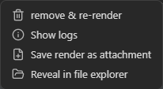
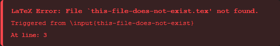

# Obsidian LaTeX Compiler

This Obsidian plugin lets you use a full LaTeX compiler right inside Obsidian code blocks. You can write complete documents, use files and images from your vault, and export your work as a PDF or SVG. It works just like a regular LaTeX setup, but everything happens in Obsidian. All you need to do is install the plugin; no extra steps required. Despite what it can do, it’s small, uses memory carefully, and works on Android too.

The plugin includes two LaTeX engines, pdfTeX and XeTeX. It downloads TeX Live packages as needed and caches them for future use. You can reference files in your vault as you would in a regular LaTeX project, and the plugin makes them available during compilation. It then displays the result as a PDF or converts it to SVG using [poppler-pdf2svg](https://github.com/kalmanmoshe/poppler-pdf2svg), caching the result for later use. You can also view a formatted compilation log at any time.

<table>
  <tr>
    <td width="50%" align="center" valign="top">
      
      <br>
      <sub><code>latex</code> -> PDF</sub>
    </td>
    <td width="50%" align="center" valign="top">
      
      <br>
      <sub><code>latexsvg</code> -> SVG</sub>
    </td>
  </tr>
</table>
## Features
### Write complete LaTeX documents.

The plugin is designed to behave like a normal LaTeX compiler, rather than a limited renderer for equations or TikZ. It supports complete and complex LaTeX documents, including document classes, sections, environments, macros, and multi-page output.

### Render as PDF or SVG
You can render the same LaTeX as either a PDF or SVG. To render the code block as a PDF, use the `latex` language in the header; for SVG, use the `latexsvg` language. You can switch between them anytime by changing the code block language.

<p align="center">
  
</p>

You can control the SVG background and sizing behavior from the plugin settings, and exported notes are handled correctly whether the code block renders as PDF or SVG.

#### TikZ code blocks

If you already use `tikz` code blocks, you can keep them as-is. The plugin supports the same block type for compatibility, so you don’t need to rewrite existing notes.
### Use files from your vault, even code blocks

Your LaTeX code doesn’t have to be in just one code block. You can reuse code and include images by referencing them just like you would in a regular LaTeX project.

For example, suppose your vault looks like this:

```
Vault/
├── MathNotes/
│   ├── references.bib
│   ├── shared/
│   │   └── mathmacros.sty
│   └── chapters/
│       ├── introduction.tex
│       └── math.md
└── attachments/
    └── diagram.png
```

If your LaTeX block is inside `MathNotes/chapters/math.md`, paths are resolved relative to that note.

```latex
% You can reference a file in the same folder:
\input{introduction.tex}

% go up one folder:
\addbibresource{../references.bib}

% go up one folder and into another:
\usepackage{../shared/mathmacros}

% or start from the vault root:
\includegraphics{/attachments/diagram.png}
```

You can also use `./` explicitly for the current directory, so `./introduction.tex` and `introduction.tex` both refer to the same file here.

This works with most other files, like. `.png`, `.cls`, and  `.pk`, basically any files that LaTeX can use.
#### Code-block dependencies

You can reference another code block as a dependency. If a block is only meant to be included elsewhere and doesn't need to render on its own, use the `latex-file` code block type and give it a name:

````md
```latex-file name: my-super-amazing-codeblock
Some incredible LaTeX...
```
````

To reference it, add`::` before the name you gave the code block:

```latex
\input{::my-super-amazing-codeblock}
```

And if the code block is in another note, put the note path before`::`

```latex
\input{some note.md::my-super-amazing-codeblock}
```
The same `name:` syntax also works with `latex`, `latexsvg`, and `tikz` code blocks. You can also reference those blocks as dependencies, just unlike `latex-file`, they will still compile and render normally.
<p align="center">
  
</p>

### Use TeX packages

The compiler can use TeX Live packages just like a normal LaTeX installation. If a required package is not already available, the plugin downloads it automatically and caches it for future compilations. 

You do not need a constant internet connection to use the plugin. You only need internet access the first time a package is downloaded; after that, you can reuse the cached copy offline.

This means you can use packages such as `TikZ`, `amsmath`, `bibliography` tools, and many others without installing or configuring TeX separately.

### Work with your rendered output.
Every render has a menu with actions for working with the generated result. You can save the output to your vault, inspect the compilation log, recompile the code block, and access additional actions specific to PDF or SVG output.
To open the menu for an SVG render, right click the SVG. For a PDF render, click the three-dot menu in the top-right corner of the PDF toolbar.

<p align="center">
  
</p>
### See what TeX actually did

The plugin lets you avoid guessing what went wrong with your LaTeX or digging through the console. Compilation errors appear directly on the rendered block with the error message and, when possible, the relevant source line.

<p align="center">
 
</p>

At any time, if you want to see the full LaTeX log, just open the menu and choose the log option. You'll get a structured view of the full log (which you can view and copy), a list of all warnings and errors, and a display showing the logged dependencies used and how they connect.

<p align="center">
  
</p>

### Runs on desktop and Android

The compiler runs inside Obsidian and doesn't need a system LaTeX installation or any other external program. This means the plugin also works on Android, where setting up a traditional TeX environment is usually much harder.

The bundled compiler and conversion runtimes have been heavily optimized for download size and memory usage, making a full LaTeX environment practical even on mobile devices.

**iOS:** Compilation is currently disabled on iOS, but cached renders can still be displayed. If you keep the cache in your vault, you can view synced renders from another device on iOS.


---


## Development

The generated compiler worker files are included in the repository, so you do not need to build SwiftLaTeX or the PDF-to-SVG runtime from source just to build the plugin.

If you only want to build the plugin from the generated files already included in the repository, skip to [Build the plugin](#build-the-plugin).

### Build everything from source

To rebuild the compiler and rendering components as well as the plugin itself:

1. Clone this repository and enter it.
2. Install the dependencies:
	```bash
	npm install
	```
3. Clone the [SwiftLaTeX fork](https://github.com/kalmanmoshe/SwiftLaTeX).
4. Install the [Emscripten SDK](https://emscripten.org/docs/getting_started/downloads.html) and Git Bash.
5. Create the local build configuration:
	```powershell
	Copy-Item scripts\local-config.example.ps1 scripts\local-config.ps1
	```
	Then edit `scripts/local-config.ps1` and fill in the required paths for your SwiftLaTeX checkout, Emscripten SDK, and Git Bash installation.
6. From the plugin repository, build SwiftLaTeX:
	```bash
	npm run build:swiftlatex
	```
	This builds the pdfTeX, XeTeX, and DVIPDFM workers, copies them into the plugin source tree, and generates their compressed payloads.
7. Build the [poppler-pdf2svg fork](https://github.com/kalmanmoshe/poppler-pdf2svg), then replace:
	```text
	src/latexRender/pdfConversion/pdfToSvgWasm.js
	```
	with the newly generated `pdfToSvgWasm.js`.
8. Regenerate the compressed payloads:
	```bash
	npm run generate:payloads
	```
	This is required again after rebuilding `pdfToSvgWasm.js` so the newly generated PDF-to-SVG WASM is compressed and included alongside the compiler payloads.
9. Build and bundle the plugin:
	```bash
	npm run build
	```
	The final plugin bundle is written to `main.js`.

### Build the plugin

If you do not need to rebuild SwiftLaTeX or the PDF-to-SVG runtime from source:

1. Clone this repository and enter it.
2. Install the dependencies:
	```bash
	npm install
	```
3. Generate the compressed payloads from the compiler and PDF-to-SVG files already included in the repository:
	```bash
	npm run generate:payloads
	```
4. Build and bundle the plugin:
	```bash
	npm run build
	```
	The final plugin bundle is written to `main.js`.

